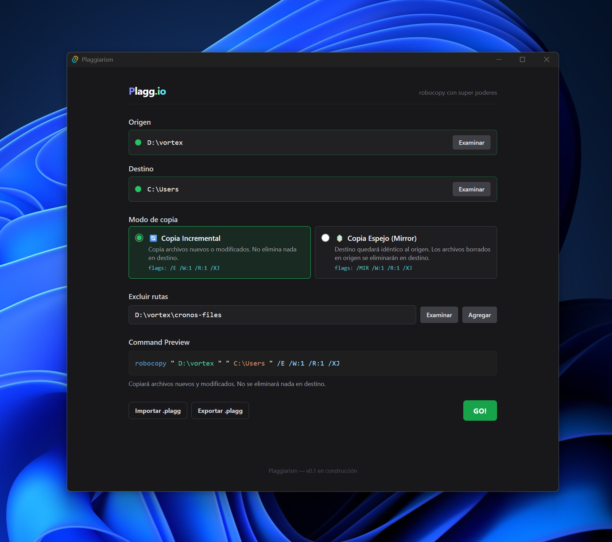

<div align="center">

# plaggiarism

### Robocopy with super powers ⚡

Copias y respaldos en Windows, con la potencia de **robocopy** y sin pelear con la consola.


[](https://github.com/m01x/plaggiarism/releases/latest)

**[⬇ Descargar plaggiarism.exe](https://github.com/m01x/plaggiarism/releases/latest)** · portable · ~9 MB · sin instalación



</div>

---

## ¿Qué es?

Plaggiarism es una interfaz gráfica para **robocopy**, la herramienta de copia robusta que ya trae Windows. Es un solo `.exe`: lo descargas, lo abres y copias.

No reimplementa robocopy. Ejecuta el robocopy real de tu sistema y traduce su salida a algo que se entiende.

## ¿Por qué usarlo?

Arrastrar carpetas en el Explorador sirve hasta que algo falla a mitad de camino. **Robocopy** es mucho mejor para respaldos: reintenta, copia solo lo que cambió y puede dejar una carpeta como espejo exacta de otra. El problema es que se usa por consola, con flags como `/MIR /W:1 /R:1 /XJ`, y un error puede borrar archivos.

Plaggiarism te da lo bueno de robocopy sin ese riesgo:

| | |
|---|---|
| 👀 **Ves lo que vas a ejecutar** | Vista previa del comando con colores, al estilo VS Code, y un resumen en lenguaje humano. |
| 🛡️ **Valida antes de copiar** | Revisa que las rutas existan, que origen y destino no estén uno dentro del otro y que haya espacio suficiente en el destino. |
| 🪞 **Mirror con confirmación** | Antes de un espejo te dice cuántos archivos se eliminarían en el destino. Nada se borra sin que lo confirmes. |
| 🚀 **Progreso real** | Cuenta los archivos restantes y muestra una animación *hyperspace* que reacciona a los errores. |
| 📋 **Resultado legible** | Copiados, saltados y fallidos, con el código de error de cada archivo que falló. Sin dumps crudos. |
| 💾 **Configuraciones `.plagg`** | Exporta un respaldo e impórtalo en otro equipo, o compártelo con un colega. |

## Cómo se usa

1. Elige la carpeta **Origen**.
2. Elige la carpeta **Destino**.
3. Elige un **modo**:

   | Modo | Qué hace | Flags |
   |---|---|---|
   | 🔄 **Incremental** | Copia lo nuevo o modificado. **Nunca borra nada** en el destino. | `/E /W:1 /R:1 /XJ` |
   | 🪞 **Mirror** | Deja el destino idéntico al origen. **Puede eliminar** archivos en el destino. | `/MIR /W:1 /R:1 /XJ` |

4. Si quieres, agrega rutas para excluir. Luego pulsa **GO!**

Plaggiarism primero hace un escaneo (`robocopy /L`, que no copia nada) para contar archivos y validar el espacio. Después copia y al final muestra el resultado.

## Stack técnico

| Capa | Tecnología |
|---|---|
| App de escritorio | **Tauri v2**: ejecutable liviano, sin Electron |
| Frontend | **React 19 + TypeScript + TailwindCSS** |
| Backend | **Rust**: subprocess de robocopy, parser de stdout y WinAPI |
| Config | JSON con extensión `.plagg` |

```
React (UI) ──invoke──▶ Tauri command (Rust) ──spawn──▶ robocopy.exe
     ▲                                                     │
     └───── eventos (archivo completado, error, fin) ◀── parser de stdout línea a línea
```

### Detalles técnicos

- **Parser del resumen de robocopy independiente del idioma**: lee las filas por posición y no por etiqueta, así que no depende de que Windows esté en español o en inglés. Decodifica la salida en `windows-1252`, no en UTF-8.
- **El exit code como máscara de bits** (1 = copió, 2 = extras, 4 = discrepancias, 8 = fallos, 16 = fatal), mapeado a estados visuales. Si hubo fallidos, el estado nunca es verde.
- **Progreso por conteo de archivos**: el escaneo `/L` da el total y cada archivo completado lo descuenta. El porcentaje que imprime robocopy es por archivo, no global, así que no se usa.
- **Cancelación segura** del proceso en curso.
- **Espacio en disco** consultado vía WinAPI antes de copiar.
- **Stateless**: no escribe en `%APPDATA%`, no hay registro ni historial oculto.
- Desarrollado con **Spec-Driven Development**: cada feature parte de un spec en [`.specs/`](.specs/).

## Q&A

<details>
<summary><b>¿Tengo que instalar algo?</b></summary>

No. Solo necesitas **WebView2**, que ya viene en Windows 11 y en Windows 10 actualizado. En equipos más antiguos se instala con el [Evergreen Bootstrapper](https://developer.microsoft.com/microsoft-edge/webview2/).
</details>

<details>
<summary><b>¿Puede borrar mis archivos?</b></summary>

Solo en modo **Mirror**, y siempre después de mostrarte cuántos archivos se eliminarían y de que lo confirmes. El modo **Incremental** nunca borra nada.
</details>

<details>
<summary><b>Windows dice "Windows protegió su PC"</b></summary>

El `.exe` no está firmado con certificado, así que SmartScreen avisa si lo descargaste por navegador. Tienes tres opciones:

1. Pulsar **"Más información" → "Ejecutar de todas formas"**.
2. Quitarle la marca de descarga con PowerShell: `Unblock-File .\plaggiarism.exe` (o en Propiedades → **Desbloquear**).
3. Distribuirlo por copia de red. Así no recibe la marca y no aparece el aviso.

En entornos con **AppLocker/GPO** se puede permitir con una regla por hash o por ruta. El SHA256 de cada versión está en las notas del [release](https://github.com/m01x/plaggiarism/releases).
</details>

<details>
<summary><b>¿Guarda mis datos o configuraciones?</b></summary>

No. La app no guarda estado. Si quieres reutilizar una configuración, exporta un archivo `.plagg` y vuelve a importarlo cuando lo necesites.
</details>

<details>
<summary><b>¿Funciona en macOS o Linux?</b></summary>

No. Robocopy es exclusivo de Windows.
</details>

## Desarrollo

**Requisitos:** Windows, Node.js + pnpm y Rust (`rustup` + MSVC build tools).

```bash
pnpm install                  # dependencias del frontend
pnpm tauri dev                # app completa en modo desarrollo
pnpm tauri build --no-bundle  # .exe portable → src-tauri/target/release/plaggiarism.exe
```

```bash
# en src-tauri/
cargo test
cargo clippy
cargo fmt
```

## Licencia

[MIT](LICENSE) © 2026 Flavio (M01x)

<div align="center"><sub>Futura identidad: <b>plagg.io</b></sub></div>
